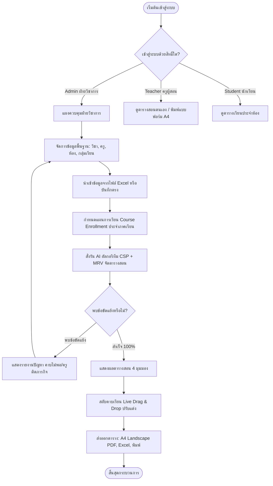
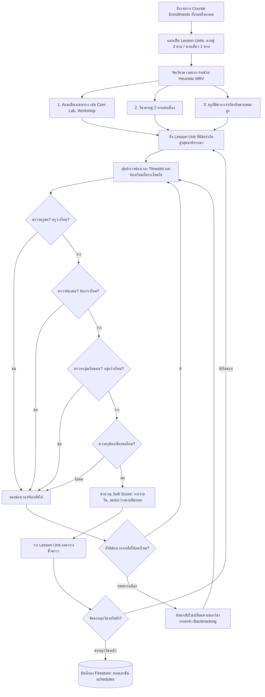
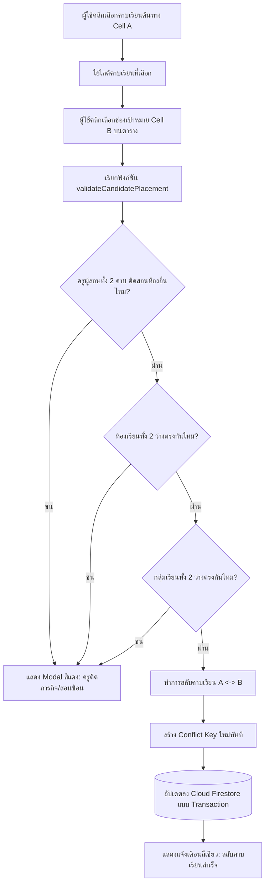
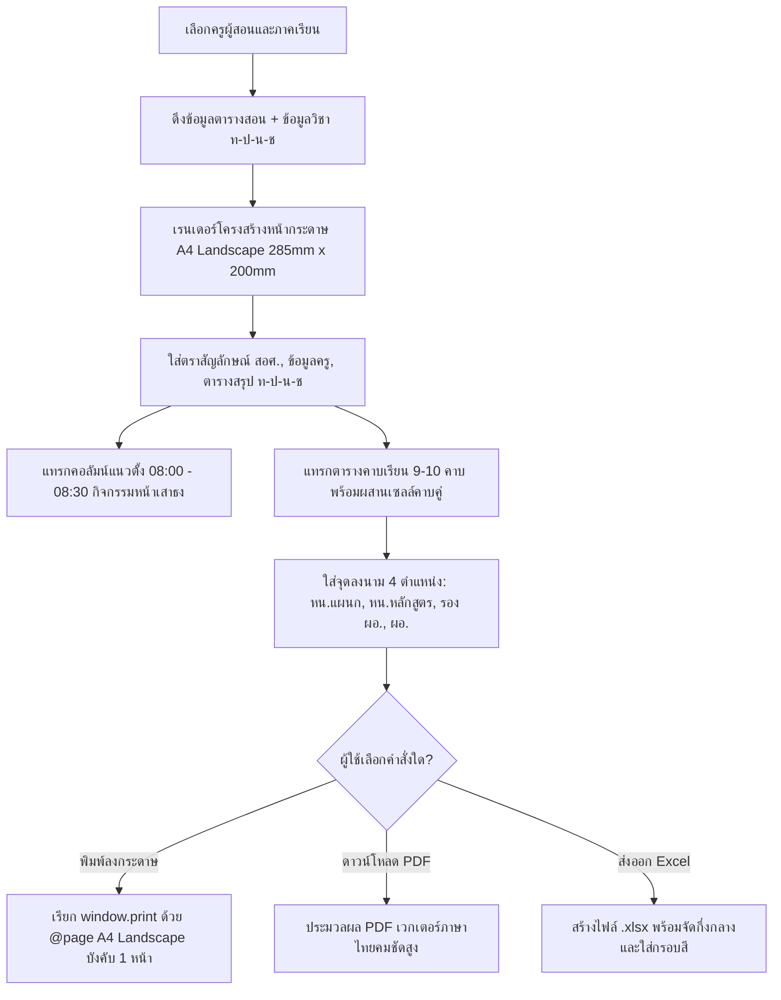

# 📊 ผังงานการทำงานของระบบ (System Flowcharts)
> โปรเจกต์: **Learning-Table** (Smart Class & Course Scheduler)

---

## 1. ผังงานภาพรวมการทำงานของระบบ (Overall System Flow)

---

## 2. ผังงานอัลกอริทึมจัดตารางสอน (CSP + Heuristic MRV Scheduler)

---

## 3. ผังงานระบบสลับคาบเรียน Real-time (Interactive Swap Flow)

---

## 4. ผังงานการพิมพ์และส่งออกเอกสารราชการ A4 แนวนอน (Official Export Flow)

